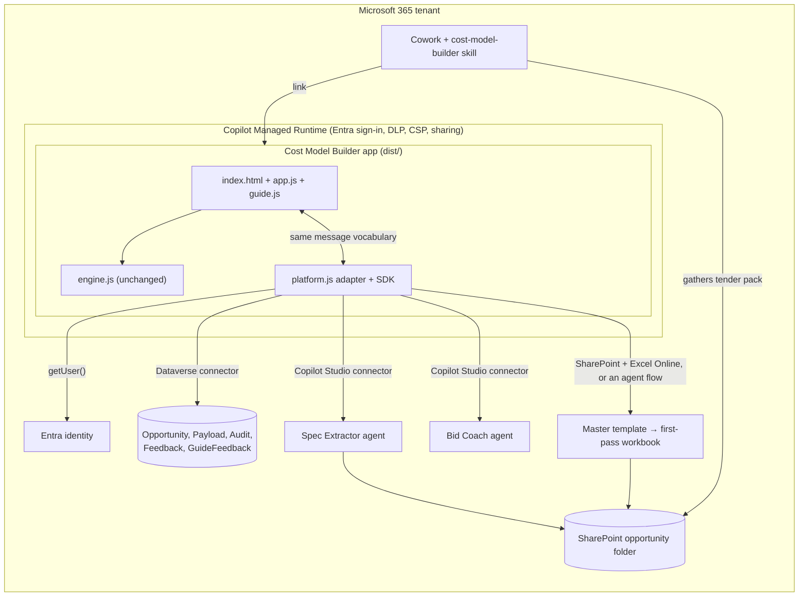

# Cost Model Builder as a managed app (Copilot Managed Runtime)

How to move the Cost Model Builder into Microsoft 365 as a governed, hosted app that sellers open from Cowork or from https://managedapps.cloud.microsoft, and what Cowork itself does around it.

> Status: the code-side preparation is done and tested in this folder (build, adapter, CSP check, tests). Nothing is deployed. Everything that needs the tenant — Frontier enrolment, the environment, connectors, agents and the Git repository — is listed in §4 and §8 with who does it. Copilot Managed Runtime and the Cowork App skill are in preview; commands and limits below come from the Microsoft Learn preview docs as of September 2026, so check them again before each phase.

## 1. The short answer

- **Don't rebuild the app with the Cowork App skill.** The App skill builds new apps from a description. Rebuilding would throw away an engine that matches the completed workbooks to the penny on 20 runs and passes 45 tests.
- **Register the existing code as a managed app with the `ms` CLI** (`ms app init`). A Cowork-built app, a Copilot Studio app and a CLI app are the same thing on the platform: the same runtime, Entra sign-in, DLP, sharing, admin-center listing and URL. Sellers can't tell how it was made.
- **Use Cowork for the work around the app:** a Cowork skill that gathers the tender pack and hands the seller to the app (`cowork/skills/cost-model-builder/SKILL.md`), and, if wanted later, small companion apps built with the App skill (see §9).
- **Wire the back end connector by connector.** The page already speaks a small message vocabulary. A new adapter (`platform/managed.js`) turns those messages into connector calls, so `engine.js` and the pricing logic don't change.

If you want the app to be created from inside Cowork (for example so a business owner holds it), there is a second route: create a placeholder app with the App skill, clone its repository with `ms app clone`, replace the code with this folder, and push. Apps built in Cowork are backed by platform-managed Git, so this works, but treat the app as code-owned afterwards. Don't refine it in Cowork again, because that would edit the code the tests cover.

**No command line?** `cowork/browser-route/README.md` covers three browser-only routes, in plain English:
- a browser terminal (GitHub Codespaces);
- Cowork building the app from the attached tested files;
- a colleague doing the one-off registration.

It also gives the sample-pack figures to check afterwards.

## 2. What moves where

| Today (prototype) | In the managed app | Status |
|---|---|---|
| `index.html`, `app.js`, `engine.js`, `guide.js`, `data/reference-data.js` | Copied unchanged into `dist/` by `npm run build`; served by the platform | Done. The test checks the copies are byte-identical |
| Cowork iframe host and postMessage bridge | `dist/platform.js`: the adapter plus the `@microsoft/managed-apps` SDK, loaded before `app.js` | Done for identity; the other connectors are stubs |
| `session.user` from the host | SDK `getUser()` (name and Entra object ID). Office 365 Users *MyProfile* adds the UPN | Done for the name; UPN optional |
| Opportunity autosave (localStorage, or `opportunity.save` to the host) | Dataverse table *Opportunity* through the Dataverse connector; resume offers the latest draft | Adapter ready; table and connector to add |
| Spec Extractor agent (Copilot Studio) | Microsoft Copilot Studio connector, *ExecuteCopilotAsyncV2* | Needs the connector allowed (§4) |
| Bid Coach agent (Copilot Studio) | Same connector | Needs the connector allowed |
| Build Workbook flow (Power Automate) | Option A: SharePoint *Copy file* plus Excel Online (Business) *Run script* with `templates/populateModel.ts`. Option B: a Copilot Studio agent flow called like the agents | Needs a decision and an admin exception (§5) |
| Tender documents in the browser | Stay in the browser for DOCX/XLSX/CSV reading; the agent reads PDFs from the opportunity's SharePoint folder | No change |
| Guide panel, insights view, approval route, sign-off | Unchanged | — |
| Cowork seller help | Cowork custom skill `cost-model-builder` | Written; upload it (§7) |

## 3. Architecture



**How the adapter fits.** In the managed build, `platform.js` runs first and sets `window.CMB_PLATFORM`. `app.js` sees it and runs in `managed` mode. Every feature asks `Bridge.can("identity" | "store" | "extract" | "coach" | "workbook")`. A capability is on only when its connector is wired in `platform/connectors.js` and passes its readiness check. Until then, that feature behaves as in the standalone preview: local reading, local guide search, a simulated workbook, and autosave in the browser. So each phase ships something that works.

Everything the adapter hands back goes through the same checks as before. The spec is validated field by field, a coach answer must match the open question and only real guide keys become links, and a saved opportunity must carry the `CostModelOpportunity/1` schema.

## 4. Before you start (prerequisites and admin asks)

| # | What | Who | Why |
|---|---|---|---|
| 1 | Tenant enrolled in the **Frontier** programme, with Copilot Managed Runtime and Cowork enabled | M365 admin | Both are in preview |
| 2 | Decide who pays for use: **Power Apps Premium** for sellers, or **Copilot Credits** (pay-as-you-go) | Licensing owner | Users without cover get a short grace period (about 20 operations or 5 minutes), then are blocked |
| 3 | A **shared environment** for the app, not a personal developer one. Note its ID for `--environment-id` | Power Platform admin | The CLI otherwise uses the creator's personal environment. Dataverse tables must live in the same environment |
| 4 | Choose the repository: **platform-managed Git** (simplest) or a **private GitHub** repo with the Microsoft Managed Apps GitHub app installed | Dev lead | Can't be changed later. Azure DevOps isn't supported. Public repos are blocked by default |
| 5 | Allow the **Microsoft Copilot Studio** connector for the app's environment group | Power Platform admin | It isn't in the default allow-list of 18 Microsoft first-party connectors |
| 6 | For workbook option A: unblock **Excel Online (Business) → Run script** | Power Platform admin, security | *Run script* is blocked by default as arbitrary code, even though the connector is allowed |
| 7 | Dataverse tables from DEPLOYMENT.md §4 created in that environment, with row security (owners see their own rows; bid managers see their team's) | Power Platform maker | The Dataverse connector is allowed by default, but only for create, read, update and delete. Bound and unbound actions are blocked |
| 8 | Spec Extractor and Bid Coach built as **standard** Copilot Studio agents, published to the Web app channel, and their agent names noted | Copilot Studio maker | The connector calls agents by name. Agents on the GitHub Copilot harness need a Copilot Studio workflow in between |
| 9 | Security group for sellers, and one for approvers | Entra admin | For `ms app share` and the approval route |
| 10 | Developer machine: Node 24.11 or later, Git 2.27 or later, Git Credential Manager, `npm i -g @microsoft/managed-apps-cli` | Dev | Checked here: Node 24.18, Git 2.53 |
| 11 | *Optional, for the estate map's street view:* allow the CSP exceptions in `platform/csp-exceptions.json`: `connect-src https://tiles.openfreemap.org`, `worker-src 'self'`, `img-src blob:` | Platform owner, security | The map sends only tile, font and icon requests to OpenFreeMap. It sends no site, client or price data, because the sites are drawn in the page. *Confirm* whether the preview lets an app widen its CSP. Without the exceptions, the Street map button is disabled with the reason, and the built-in outline map shows the same figures |

Connectors in the default allow-list include SharePoint, OneDrive for Business, Excel Online (Business), Dataverse, Office 365 Users, Teams and Outlook. Custom connectors, HTTP, flow-only connectors (so no direct Power Automate trigger) and third-party connectors are blocked unless an admin allows them.

## 5. Decisions to make

1. **Route.** CLI registration (`ms app init`, recommended) or Cowork-first then clone (§1).
2. **Workbook build.** Option A uses allowed connectors plus one admin exception for *Run script*, and reuses `populateModel.ts` as it is. Option B keeps the logic in a Copilot Studio agent flow, which needs only the Copilot Studio connector (already needed for the agents) but adds an agent hop and its cost. Recommendation: B if the admin won't unblock *Run script*, otherwise A.
3. **Licensing.** Power Apps Premium for a small, regular seller group; Copilot Credits for occasional users.
4. **Downloads.** The page's "Download payload / site pricing / assumptions log" buttons use browser downloads. If the managed frame blocks downloads (check in Phase 0), switch those buttons to save into the opportunity's SharePoint folder with the SharePoint connector.

## 6. Phases

Each phase ends with the release gates in §8 green and a preview check by one seller.

**Phase 0: host the app (no connectors).** About half a day once §4 items 1, 3, 4 and 10 are done.

```powershell
cd C:\CModels\CostModelBuilder
git init; git add -A; git commit -m "Cost Model Builder 3.0.0"
ms auth login
ms app init --display-name "Cost Model Builder" --environment-id <env id> --build-path ./dist --build-command "npm run build" --repo native
git push                     # the platform builds from the pushed commit when the preview is opened
ms app pack                  # optional: build locally the way the platform will, to inspect the output
ms app play                  # open the preview; check the header says "Managed app" and the name is yours
ms app deploy
ms app share --help          # share with the seller pilot group (check the flags in your CLI version)
```

Check in the preview: sign-in shows your name at sign-off; the sample packs price exactly as locally; there are no CSP errors in the console; the downloads work (decision 4); autosave and Resume work in the browser.

**Phase 1: store (Dataverse).**
`ms app add data-source` for the Opportunity table (and Payload, Audit, Feedback and GuideFeedback), then fill in `connectors.store` in `platform/connectors.js`. The adapter already batches saves every 15 seconds (`hosting.managedSaveMs`) and flushes when the tab is hidden, because every connector call is metered. Resume then offers the seller's latest draft from Dataverse.

**Phase 2: agents.** After §4 items 5 and 8. Wire `connectors.coach` first, because it's low risk and easy to test with the ten-question test in `agents/bid-coach.md`. Then wire `connectors.extract`, which must pass the extraction gate (100% precision, at least 90% held-out recall).

**Phase 3: workbook.** Wire `connectors.workbook` for option A or B. It must refuse unsigned payloads and return `{name, url}` only when the control totals match to the penny.

**Phase 4: Cowork and go-live.** Upload the skill (§7), set the app URL in it, run the shadow pilot in PILOT.md, and share the app with the seller group.

## 7. The Cowork side

- **Skill.** Upload `cowork/skills/cost-model-builder/SKILL.md`: in Cowork, go to Customize, then Skills, then Add, then Upload skill. Or put it in each user's OneDrive at `/Documents/Cowork/skills/cost-model-builder/`. First replace `<APP URL>` with the live URL. Share it from the Customize page with the seller group.
- **What the skill does.** It finds the tender pack in email, Teams and SharePoint, and asks before copying it into `Bids/<Client>/<Opportunity>/Tender pack/`. It lists which inputs are present or missing, then hands the seller the app link. It never gives a price, rate or margin. After the build, it can draft the approval request, and it asks before sending.
- **Credits.** Building or running apps from Cowork is billed in Copilot Credits under the creator's Cowork spending policy. That doesn't apply to the CLI route, where the runtime licensing in §4 item 2 applies.

## 8. Release gates (additions for the managed build)

```powershell
npm test               # 49 tests, including tests/platform.test.mjs: the build layout, the CSP check and its exceptions, and the adapter against a simulated host
npm run harness        # 20 parity runs to the penny (unchanged)
npm run build          # fails if dist/ breaks the platform's default CSP (apart from the per-file exceptions in platform/csp-exceptions.json)
npm run dev            # local loop on http://127.0.0.1:5173 with a CSP header close to the platform's, plus the street-map exceptions; `ms app dev` runs this
npm run dev:strict     # the same without the exceptions: the street map must fail politely and the outline map must carry on
```

Then, on the preview URL: no CSP errors in the console, sign-in name shown, sample-pack prices identical to local, and each wired capability listed in the header tooltip ("Connected: identity, store, …").

## 9. Optional: companion apps with the Cowork App skill

These are good fits for the App skill, because they're simple views over the same Dataverse tables and don't touch pricing:

- **Bid pipeline board.** "Build an app that lists rows from the Cost Model Opportunity table: client, sites, weekly charge, owner, approval level, status. Let bid managers filter by owner and status, and open the workbook link." It reads the same tables the main app writes.
- **Approval queue.** For approvers: the signed-off payloads waiting for them, with the approval level and the checks that triggered it.

## 10. Cost of running

As of the preview docs, with Copilot Credits each app launch and each connector call is metered at about 0.1 credit. Users with Power Apps Premium aren't metered. Check the current rate before relying on it. A typical opportunity uses about 50 to 70 metered calls, so about 5 to 7 credits:

- 1 to 3 launches;
- about 40 batched saves;
- 1 extraction;
- a handful of Bid Coach questions;
- 2 to 3 calls for the workbook.

Copilot Studio agent messages are billed separately under Copilot Studio.

## 11. Risks and open questions

| Risk | Mitigation |
|---|---|
| Preview platform: commands, limits and the SDK (0.5.x) will change | Pin `@microsoft/managed-apps` (done: 0.5.17) and check the docs at each phase |
| The Copilot Studio connector or *Run script* isn't allowed | The app still works with that feature off: local extraction, local guide, and a payload download for the bid desk |
| The managed frame blocks downloads | Save to SharePoint instead (decision 4) |
| Metered saves cost more than expected | Raise `hosting.managedSaveMs`, or give regular sellers Power Apps Premium |
| Client data in the repo | `examples/` holds tender-derived test data. Keep the repo private or platform-managed, or move `examples/` to a separate private repo before pushing |
| `platform.js` is 357 KB (SDK and telemetry) | Acceptable for an internal tool; only parse cost. Revisit if the SDK adds tree-shakable entry points |
| The platform won't widen the CSP for the street map, or a network blocks OpenFreeMap | The outline map is built in, works offline and shows every figure. The street map is an extra, and it's disabled with a plain reason when it can't load |

Open questions to settle:

- Is the tenant enrolled in Frontier?
- What is the environment ID, and who owns the environment?
- Which repository: platform-managed Git, or GitHub?
- Are both agents on the standard harness?
- Will the admin unblock Excel *Run script*?
- Which licensing model will sellers use?

## 12. Files added for this

| File | Purpose |
|---|---|
| `tools/build.mjs` | `npm run build`: copies the runtime files, bundles the adapter with esbuild, drops the meta CSP (the platform sets the header), checks CSP, writes `dist/build.json` with SHA-256 hashes |
| `tools/csp-check.mjs` | Static check against the platform's default CSP: inline script and handlers, eval, workers, external resources, forms, frames and missing files. It waives a rule only for a file that `platform/csp-exceptions.json` names |
| `tools/dev.mjs` | `npm run dev`: builds, serves `dist/` with a strict CSP header plus the requested exceptions, and rebuilds on change. `--strict` leaves the exceptions out |
| `platform/csp-exceptions.json` | The CSP exceptions the street map asks for, and the vendored files each rule is waived for. `dist/build.json` records the directives |
| `platform/managed.js` | The adapter: SDK handshake, identity, capability probes, message handlers, timeouts and notices |
| `platform/connectors.js` | Where each connector is wired, with the contracts; all `null` today |
| `map.js`, `map-street.js`, `vendor/maplibre/` | The estate map: the built-in outline map, and the optional street map (MapLibre GL JS 5, BSD-3-Clause, vendored by `npm run vendor`) |
| `tests/platform.test.mjs` | 6 tests: build layout and hashes, the standalone build, CSP rules and exceptions, and the adapter against a simulated host with and without connectors |
| `cowork/skills/cost-model-builder/SKILL.md` | The Cowork helper skill |
| `.gitignore` | Keeps `node_modules/`, `dist/` and scratch files out of the repo |
